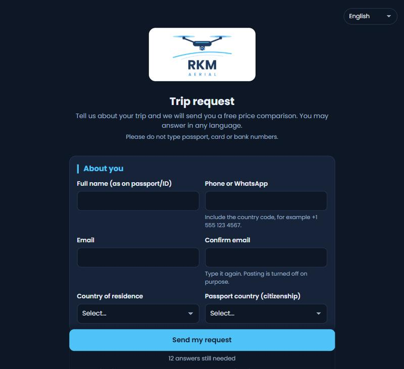
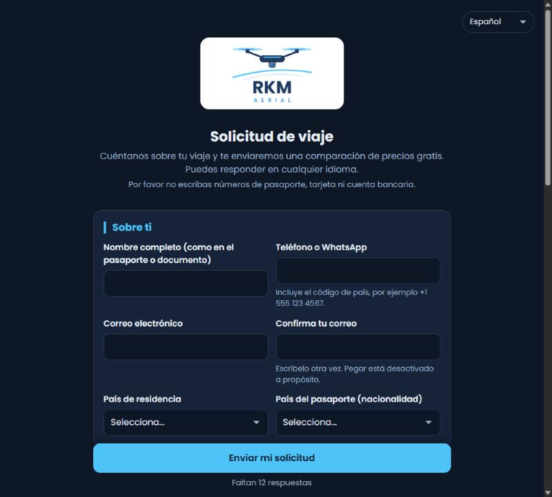
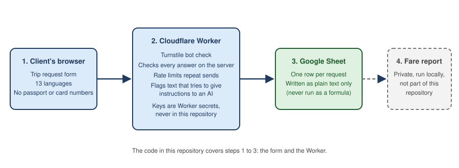

# RKMAerial trip request form

A multilingual web form and the small Cloudflare Worker behind it. A traveler describes a trip (flights, rental car, hotel). Each answer becomes one row in a Google Sheet, where RKMAerial prepares a free price comparison.

Live form: https://trip-request-form.trip-request-form.workers.dev

| English | Español |
|---|---|
|  |  |

## What it does

- Asks only for what the trip needs. The questions change with the services the traveler picks (flights, car, hotel).
- Works in 13 languages: English, Spanish, Portuguese, Italian, French, German, Russian, Dutch, Polish, Turkish, Simplified Chinese, Japanese and Korean. The traveler may answer in any language.
- Offers an airport picker for the From and To fields.
- Can pre-fill a returning traveler's details from a private link, so they do not retype them.
- Never asks for passport, card or bank numbers.

## How it works



1. The traveler fills in the form in their browser.
2. The Worker checks the request on the server and appends one row to the sheet.
3. The sheet holds one row per request.
4. The fare report is prepared privately and is not part of this repository.

## Security

- **No secrets in the code.** The Google service-account key, sheet id, Turnstile secret and pre-fill data are Worker secrets. The repository holds only `config.example.json`.
- **Bot check.** Cloudflare Turnstile must pass before a request is accepted.
- **Server-side checks.** The Worker re-checks every answer. The browser is never trusted.
- **Answers are data, never instructions.** Text that looks like an attempt to instruct an AI, or that carries code or links, is flagged `CHECK` for a person to review. It is never acted on.
- **No spreadsheet formulas.** Rows are written as plain text (`valueInputOption=RAW`), and free-text answers that start with `=`, `+`, `-` or `@` are guarded so later CSV or Excel exports do not run them.
- **Basic rate limit.** A visitor can send a limited number of requests in a ten-minute window.
- **Privacy.** See [the privacy page](public/privacy.html). Details are used to prepare the report and answer questions, and are deleted on request.

## Layout

| Path | What it is |
|---|---|
| `public/` | The form: page, styles, field list (`schema.js`), translations (`i18n/`), privacy page |
| `src/` | The Worker: request handling, input safety helpers, Google Sheets writer |
| `i18n-src/`, `scripts/` | Translation keys and the scripts that manage them |
| `test/` | Automated tests |
| `docs/` | Screenshots and diagram used in this README |

## Tests

```
npm test
```

The suite covers the safety helpers, the Worker's validation and the translations (42 tests).

## License

Copyright (c) 2026 Rafiq Mateen. All rights reserved. This code is published so it can be viewed. It is not licensed for use, copying or modification. See [LICENSE](LICENSE).
